# 1. Objective and summary

The goal is an object-detection system that both **classifies** and **localises** multiple objects per image. We fine-tuned **YOLOv11-small (`yolo11s`)** — a single-stage, anchor-free CNN detector — on a custom 4-class wildlife dataset, evaluated it with mAP, IoU and inference-speed measurements, tested it on unseen data (a held-out test split plus 6 custom photographs we annotated ourselves), and ran it on a video stream frame by frame.

| Result | Value |
|---|---|
| Model | YOLO11s, 9.46 M parameters, 21.8 GFLOPs @ 640×640, 181 layers |
| Training | 30 epochs, 9.1 min on Tesla T4 |
| **Test mAP@0.5 / mAP@0.5:0.95** | **0.940 / 0.804** (held-out test split, 266 boxes) |
| Validation mAP@0.5 / mAP@0.5:0.95 | 0.961 / 0.829 |
| Mean IoU of correct detections (test) | 0.907 |
| Custom annotated photos | 9/9 objects found, 0 false positives, mAP@0.5 = 1.000, mean IoU = 0.952 |
| Inference speed (batch 1, 640 px, Tesla T4) | 11.4 ms (87 FPS) FP32; 155 img/s with batch 16 (FP16) |
| Live video loop (720 frames, 1280×720) | 13.7 ms/frame model latency, 43.9 FPS end-to-end including drawing and video writing |

# 2. Data and pre-processing

**Dataset.** *Object Detection – Wildlife Dataset – YOLO Format* (Kaggle, `ankanghosh651`): four classes — buffalo, elephant, rhino, zebra — with YOLO-format annotations (`class x_center y_center width height`, normalised) and pre-defined train / valid / test splits. The audit below was computed by the notebook (every label file was parsed; no invalid or out-of-range lines were found).

| split | images | boxes | boxes/img | buffalo | elephant | rhino | zebra | invalid |
|---|---|---|---|---|---|---|---|---|
| train | 1203 | 2157 | 1.79 | 447 | 603 | 445 | 662 | 0 |
| val | 150 | 262 | 1.75 | 60 | 83 | 58 | 61 | 0 |
| test | 151 | 266 | 1.76 | 44 | 62 | 60 | 100 | 0 |

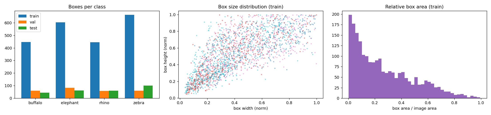

**Pre-processing pipeline.**

1. *Annotation check*: parse every label file, verify class IDs and that boxes lie inside the image.
2. *Resize*: aspect-ratio-preserving **letterbox** to 640×640 (grey padding), boxes transformed with the pixels.
3. *Normalise*: BGR→RGB, HWC→CHW, `uint8 / 255` → float32 in [0, 1].
4. *Augmentation (training only)*: mosaic (4-image tiles), random scale ±50 %, translate ±10 %, horizontal flip (p = 0.5), HSV jitter (h 0.015, s 0.7, v 0.4); mosaic is switched off for the last 10 epochs.

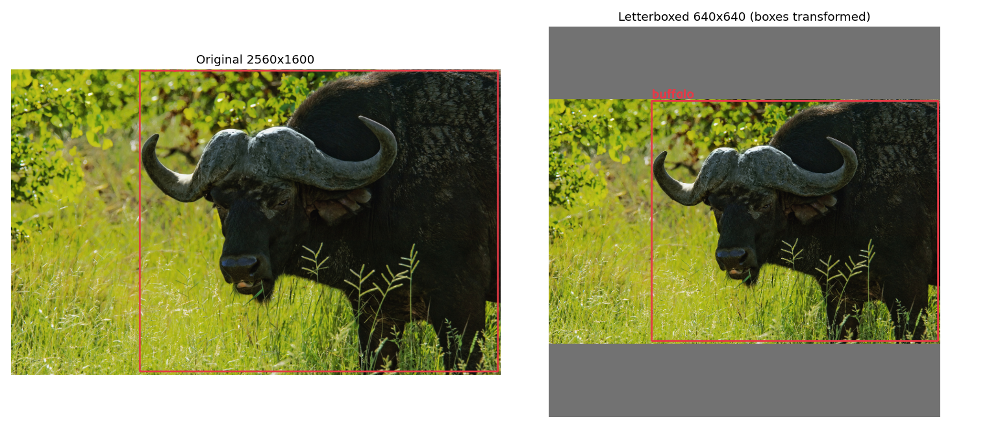

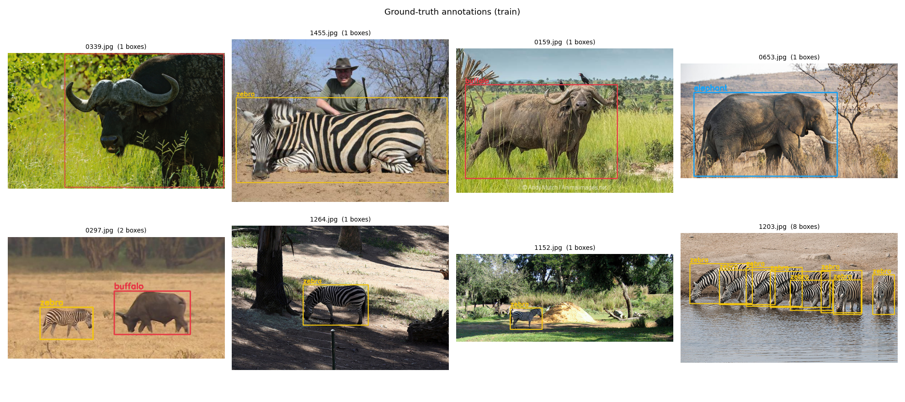

**Custom annotated images.** To check generalisation beyond the dataset we collected **6 photographs** from two independent sources (Wikimedia Commons, CC-licensed, and Open Images via a different Kaggle dataset) and **annotated 9 objects by hand** with pixel bounding boxes. The annotation table is part of the notebook (section 5b), is converted to YOLO format and was used **for evaluation only**, never for training.

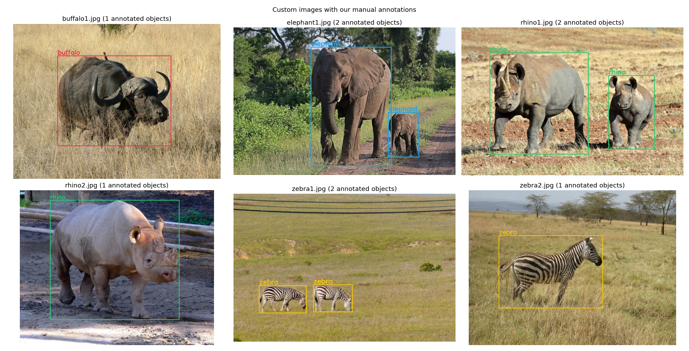

# 3. Model architecture — YOLOv11

YOLO11 is a fully convolutional, single-stage, **anchor-free** detector. We used the **small** variant.

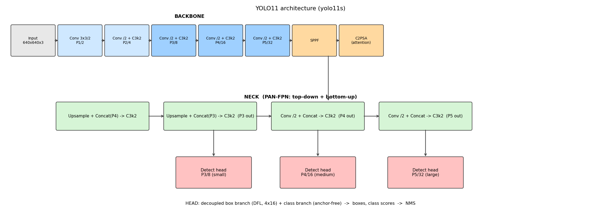

* **Backbone** (layers 0–10): strided `Conv` (Conv-BN-SiLU) layers, **C3k2** blocks (CSP bottlenecks with small kernels), **SPPF** (fast spatial pyramid pooling) and **C2PSA** (cross-stage block with position-sensitive self-attention) at the deepest stage.
* **Neck** (layers 11–22): PAN-FPN — top-down upsampling + concatenation with backbone features, then bottom-up down-sampling + concatenation, giving feature maps at strides 8, 16 and 32 for small, medium and large objects.
* **Head** (layer 23): decoupled `Detect` head per scale — a box branch (Distribution Focal Loss, 4×16 bins) and a class branch; no anchors and no objectness score; NMS at inference.
* **Loss**: CIoU box loss + DFL + binary cross-entropy classification (weights box 7.5, cls 0.5, dfl 1.5) with the task-aligned assigner.

| stage | layers | params | share |
|---|---|---|---|
| backbone | 11 | 5,441,984 | 57.5% |
| neck | 12 | 3,166,400 | 33.5% |
| head | 1 | 850,368 | 9.0% |

Model-family context (parameters / GFLOPs at 640 px, from the model YAMLs):

| variant | layers | params_M | GFLOPs@640 |
|---|---|---|---|
| yolo11n | 181 | 2.62 | 6.7 |
| yolo11s | 181 | 9.46 | 21.8 |
| yolo11m | 231 | 20.11 | 68.6 |
| yolo11l | 357 | 25.37 | 87.9 |
| yolo11x | 357 | 56.97 | 196.3 |

We chose `yolo11s` as a balance between accuracy and speed: small enough to train in minutes on one T4 and fast enough for real-time inference. The complete layer list (type, input connection, parameters) is in `yolo11s_layers.csv`; the first rows are:

| idx | module | from | params |
|---|---|---|---|
| 0 | Conv | -1 | 928 |
| 1 | Conv | -1 | 18,560 |
| 2 | C3k2 | -1 | 26,080 |
| 3 | Conv | -1 | 147,712 |
| 4 | C3k2 | -1 | 103,360 |
| 5 | Conv | -1 | 590,336 |
| 6 | C3k2 | -1 | 346,112 |
| 7 | Conv | -1 | 1,180,672 |
| 8 | C3k2 | -1 | 1,380,352 |
| 9 | SPPF | -1 | 656,896 |
| 10 | C2PSA | -1 | 990,976 |
| 11 | Upsample | -1 | 0 |

# 4. Training process

* **Transfer learning**: COCO-pre-trained `yolo11s.pt` fine-tuned end-to-end on the wildlife data (classification head adapted to 4 classes).
* **Hyper-parameters**: 30 epochs, batch 16, image size 640, mixed precision (AMP, FP16), early-stopping patience 10, seed 42, warm-up 3.0 epochs, weight decay 0.0005, linear LR decay (final LR factor 0.01). With `optimizer=auto` Ultralytics selected **AdamW with lr = 0.00125** (the run is short, under 10 000 iterations).
* **Model selection**: the checkpoint with the best validation fitness (`best.pt`) is used for every result below.
* **Cost**: 9.1 min for 30 epochs on one Tesla T4.

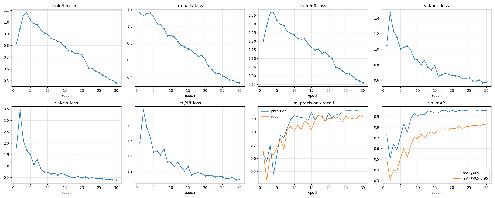

Validation mAP@0.5:0.95 rose from 0.507 (epoch 1) to 0.829 at the last epoch (best epoch: 30); box, class and DFL losses fall steadily. Because the best epoch is the last one, validation accuracy was **still improving** when training stopped — a longer schedule would likely add a little accuracy; we kept 30 epochs to stay within the time budget.

# 5. Evaluation

**Metrics.** mAP@0.5 (a detection is correct if IoU ≥ 0.5), mAP@0.5:0.95 (mean AP over IoU thresholds 0.50–0.95, the strict localisation-aware metric), precision, recall, per-class AP, and IoU computed directly between predicted and ground-truth boxes. Validator settings: conf 0.001, NMS-IoU 0.6, 640 px.

| split | precision | recall | mAP@0.5 | mAP@0.75 | mAP@0.5:0.95 |
|---|---|---|---|---|---|
| validation | 0.961 | 0.930 | 0.961 | 0.899 | 0.829 |
| **test (unseen)** | 0.954 | 0.861 | 0.940 | 0.867 | 0.804 |

Per-class results on the **test** split:

| class | precision | recall | AP@0.5 | AP@0.5:0.95 |
|---|---|---|---|---|
| buffalo | 0.947 | 0.795 | 0.929 | 0.843 |
| elephant | 0.945 | 0.835 | 0.907 | 0.733 |
| rhino | 0.954 | 0.933 | 0.962 | 0.843 |
| zebra | 0.971 | 0.880 | 0.962 | 0.799 |

The best class is **rhino** (AP@0.5:0.95 = 0.843) and the weakest is **elephant** (0.733).

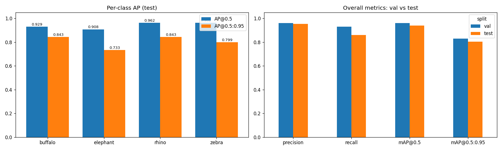

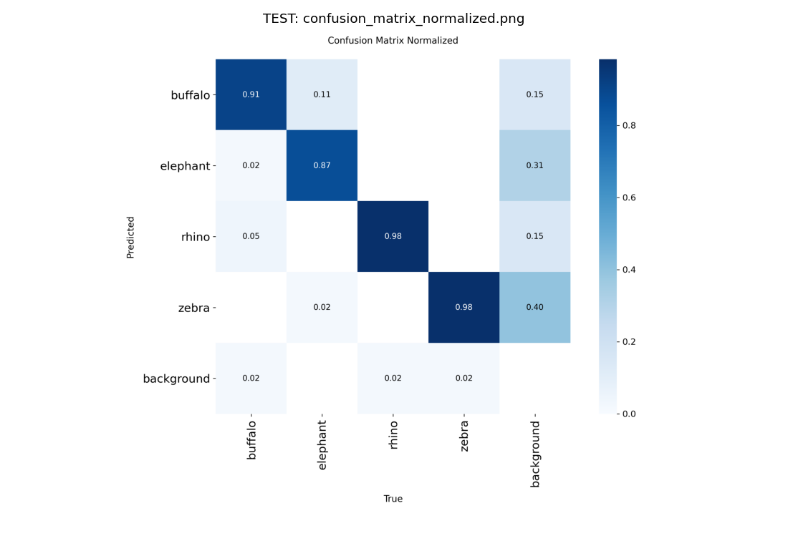

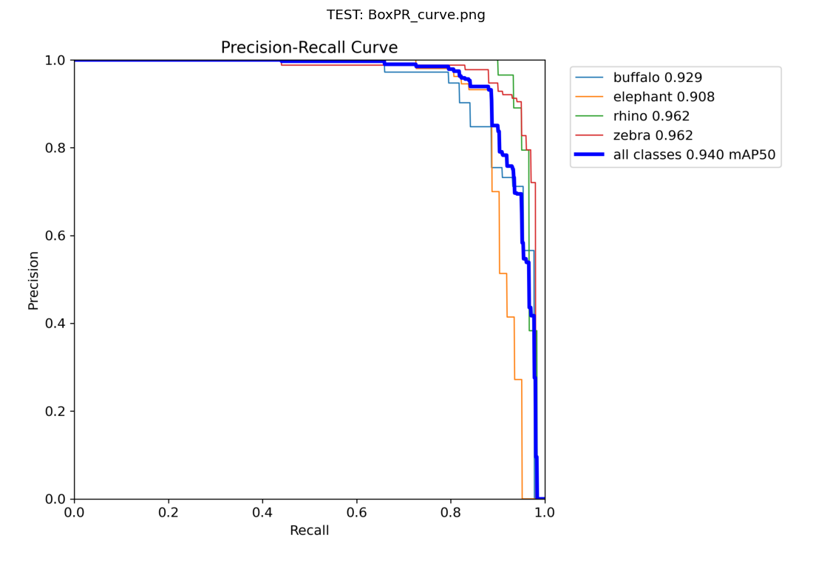

**IoU analysis.** Predictions with confidence ≥ 0.25 were greedily matched (highest confidence first) to same-class ground-truth boxes; a match with IoU ≥ 0.5 is a true positive.

| TP | FP | FN | precision | recall | F1 | mean IoU of TPs | mean best-IoU per GT object |
|---|---|---|---|---|---|---|---|
| 245 | 36 | 21 | 0.872 | 0.921 | 0.896 | **0.907** | 0.852 |

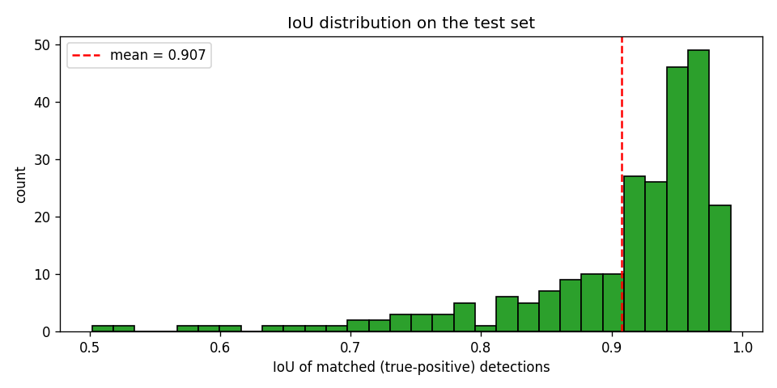

**Inference speed** (`model.predict`, includes pre-processing, forward pass and NMS; 20 warm-up + 100 timed runs; a fresh model object per configuration):

| device | image size | precision | batch | latency (ms/img) | FPS |
|---|---|---|---|---|---|
| Tesla T4 | 320 | FP32 | 1 | 11.2 | 89.1 |
| Tesla T4 | 320 | FP16 | 1 | 11.7 | 85.3 |
| Tesla T4 | 640 | FP32 | 1 | 11.4 | 87.5 |
| Tesla T4 | 640 | FP16 | 1 | 13.2 | 75.6 |
| Tesla T4 | 960 | FP32 | 1 | 20.1 | 49.7 |
| Tesla T4 | 960 | FP16 | 1 | 13.8 | 72.4 |
| Tesla T4 | 640 | FP16 | 16 | 6.4 | 155.1 |
| CPU | 640 | FP32 | 1 | 113.2 | 8.8 |

At batch size 1 the latency is dominated by CPU-side work (image decoding, letterboxing, NMS and Python overhead, roughly 10 ms), so lowering the resolution or switching to FP16 does not help there; the GPU-side gain appears at larger inputs (13.8 ms FP16 vs 20.1 ms FP32 at 960 px) and with batching (155 img/s at batch 16). On CPU alone the model still runs at about 9 FPS.

# 6. Testing on unseen data

**Held-out test split.** The 151 test images were never used for training or checkpoint selection; the gap between validation and test mAP@0.5:0.95 (0.829 vs 0.804) is small, so the model generalises.

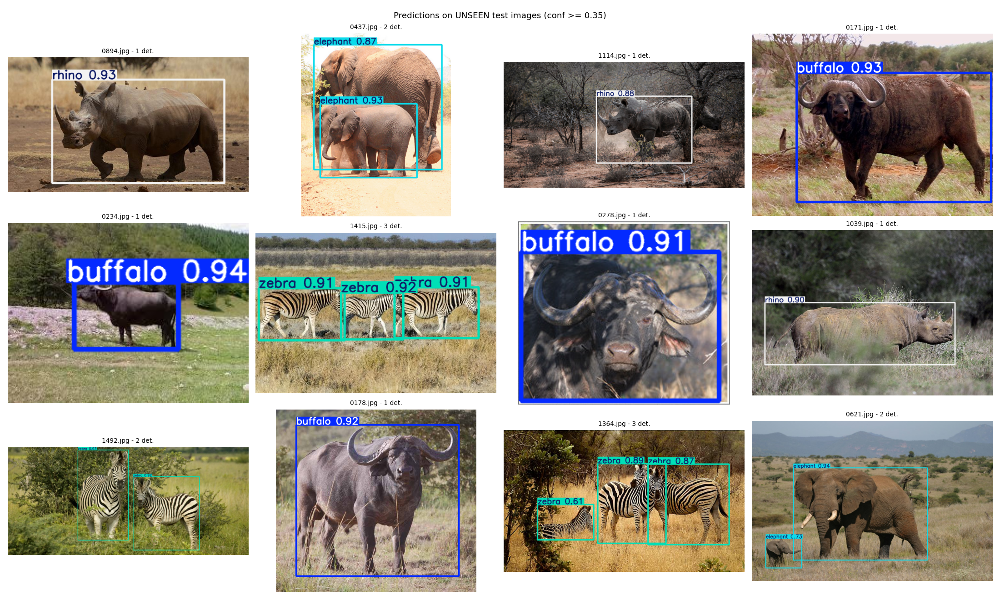

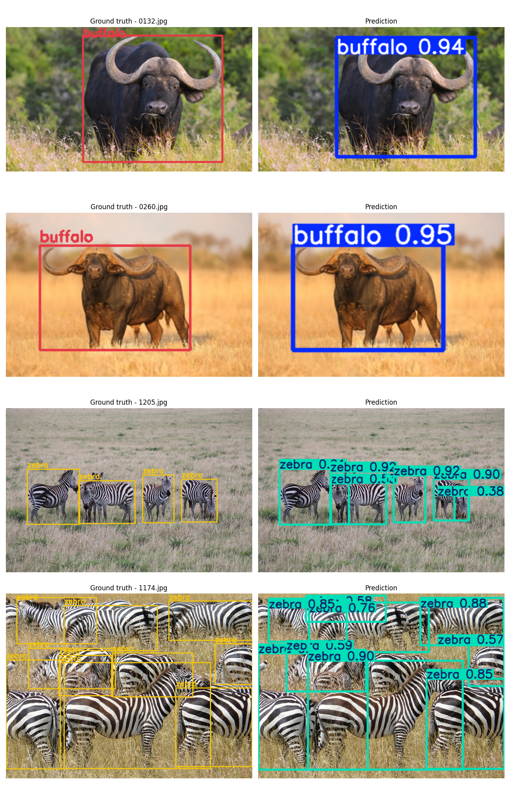

**Our own annotated photographs (6 images, 9 objects).** At conf ≥ 0.25 the model found **9 of 9** annotated animals with **0 false positives** (precision 1.000, recall 1.000), mean IoU 0.952; validator mAP@0.5 = 1.000, mAP@0.5:0.95 = 0.921. With only 9 objects this is a sanity check on independent images, not a statistically tight estimate.

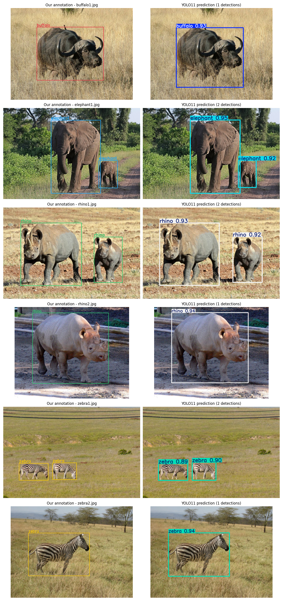

**Robustness to image corruptions** (test split, conf 0.25, IoU 0.5):

| condition | precision | recall | F1 | mean IoU (TP) |
|---|---|---|---|---|
| clean | 0.872 | 0.921 | 0.896 | 0.907 |
| darker (x0.45) | 0.900 | 0.917 | 0.909 | 0.911 |
| gaussian blur (sigma=4) | 0.844 | 0.650 | 0.735 | 0.892 |
| noise (sd=25) | 0.806 | 0.752 | 0.778 | 0.887 |
| JPEG q=10 | 0.832 | 0.801 | 0.816 | 0.878 |

Darkening barely matters; blur is the most damaging corruption (recall 0.650 vs 0.921 clean), followed by JPEG compression and sensor noise. Localisation quality of the detections that remain stays high (mean IoU ≥ 0.878).

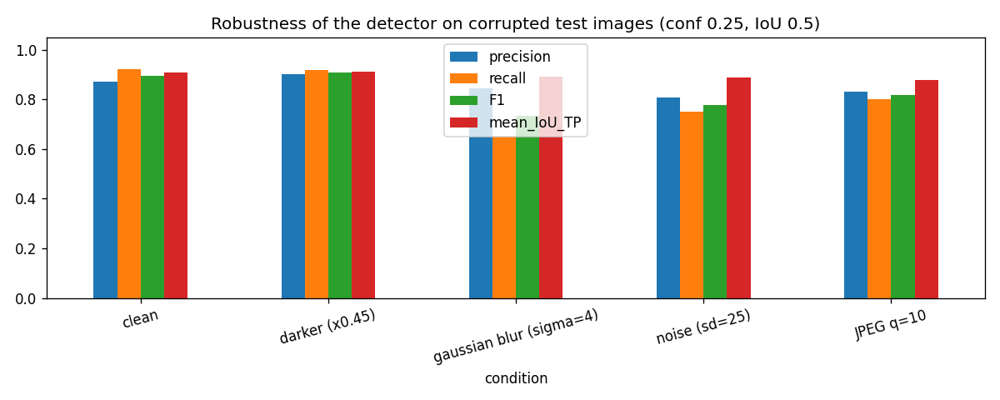

**Failure analysis.** The images with the most errors are crowded herds with heavy overlap and small distant animals. In several of them the model detects real animals that the ground truth does not label (counted as false positives), or splits/merges overlapping individuals, and the confusion matrix shows the main class confusion is between elephant and buffalo, which are similar in colour and silhouette at low resolution.

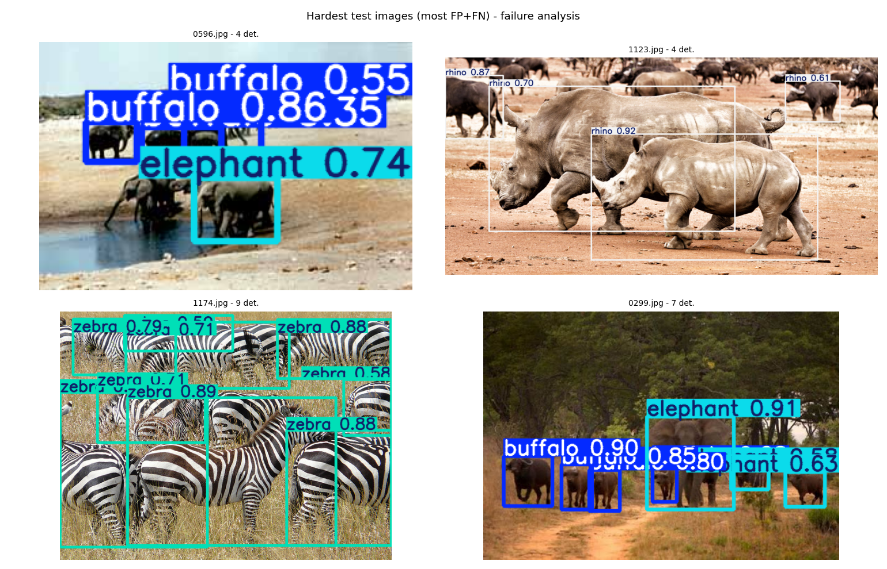

# 7. Live prediction on frames

The notebook builds a 1280×720, 30 fps demonstration video from unseen test images (each shown as a short clip with a slow camera zoom; Kaggle has no camera) and runs the detector **frame by frame** with a real-time loop: read frame → `predict` → draw boxes → overlay latency/FPS → write frame. The same loop works on a webcam or RTSP stream (`live_predict.py`). A second pass uses the **ByteTrack** tracker to give each animal a persistent ID.

* 720 frames processed; mean model latency **13.7 ms** (p95 15.1 ms); **43.9 FPS** end-to-end including drawing and video encoding — above the 30 fps of the source, i.e. real time.
* Outputs: `videos/live_prediction.mp4`, `videos/live_tracking.mp4`, `videos/live_prediction_preview.gif`.

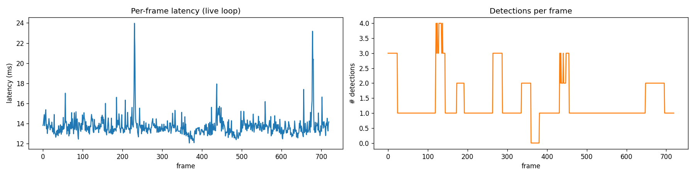

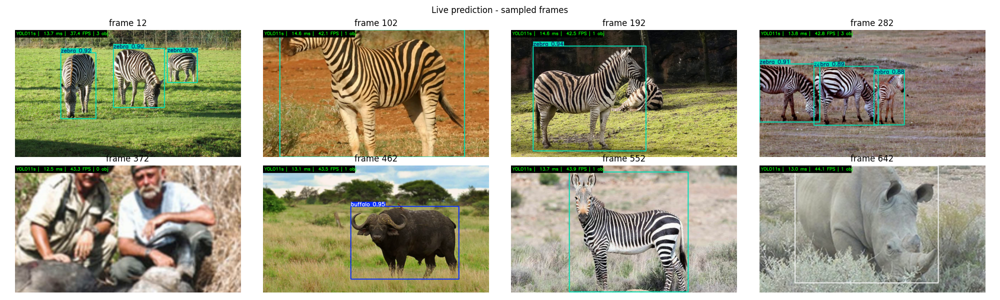

# 8. Deliverables

| File | Content |
|---|---|
| `yolo11s_wildlife_best.pt` (+ `last.pt`, `.onnx` if exported) | Trained YOLOv11 detector |
| `yolo11_wildlife_detection_executed.ipynb` | Final notebook with all outputs (run on Kaggle Tesla T4) |
| `REPORT.docx` / `REPORT.md` | This report |
| `live_predict.py` | Stand-alone live prediction script (webcam / video / stream, optional tracking) |
| `results_summary.json`, `metrics_*.csv`, `inference_speed.csv`, `robustness.csv`, `training_history.csv` | All numbers used in the report |
| `figures/`, `ultralytics_plots/` | All plots |
| `videos/` | Live prediction and tracking videos |
| `custom_annotated_images/` + `custom_annotations.csv` | Our 6 annotated photographs and YOLO labels |

# 9. Limitations and notes

* One training run with a single seed; differences of about 0.01 in mAP between runs are within noise.
* Test-split annotations are incomplete in crowded scenes (unlabeled animals), which lowers precision and mAP somewhat; the custom set is small (9 objects).
* Training stopped at the epoch limit while still improving; more epochs would likely help.
* The video is synthesised from still images, so tracking quality on real moving footage is not measured here.
* Software: Ultralytics 8.4.219, PyTorch 2.11.0+cu130, Tesla T4.
